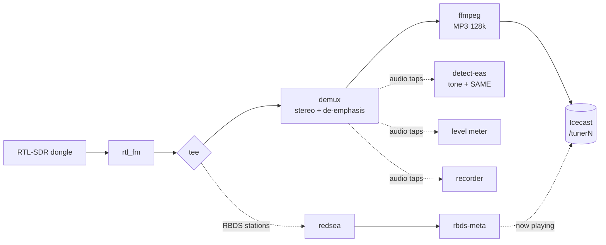

# Pi-Tuner manual

The complete guide to installing, configuring, running and troubleshooting
Pi-Tuner. The [README](../README.md) is the short version; this is everything.

## Contents

1. [What Pi-Tuner is](#1-what-pi-tuner-is)
2. [How it works](#2-how-it-works)
3. [What you need](#3-what-you-need)
4. [Installing](#4-installing)
5. [Security](#5-security)
6. [Dongle serial numbers](#6-dongle-serial-numbers)
7. [Stations](#7-stations)
8. [Day-to-day commands](#8-day-to-day-commands)
9. [Upgrading and changing settings](#9-upgrading-and-changing-settings)
10. [RBDS now-playing](#10-rbds-now-playing)
11. [Recording](#11-recording)
12. [EAS alerts: tone detection and SAME decoding](#12-eas-alerts-tone-detection-and-same-decoding)
13. [Email alerts](#13-email-alerts)
14. [Zabbix monitoring](#14-zabbix-monitoring)
15. [Logs](#15-logs)
16. [Configuration reference](#16-configuration-reference)
17. [Troubleshooting](#17-troubleshooting)
18. [Uninstalling](#18-uninstalling)
19. [Appendix: SAME code tables](#19-appendix-same-code-tables)

---

## 1. What Pi-Tuner is

Pi-Tuner turns cheap RTL-SDR USB dongles into internet radio stations. A
Raspberry Pi runs one Python program (`tuner.py`, standard library only) under
systemd. Each station is a small text file; each station gets its own dongle,
its own `rtl_fm` pipeline and its own Icecast mount. There is no web interface
and no database.

| Feature | What it does |
|---------|--------------|
| FM and weather radio | Stereo FM, plus NOAA Weather Radio in mono |
| Icecast streaming | Every station is a 128 kbps MP3 stream on its own mount: `/tuner1`, `/tuner2`, … |
| RBDS now-playing | Shows `Artist - Title (PS)` in Icecast. The program type (PTY) becomes the genre (`Radio` if none, `Weather` for WX) |
| Recording | Optionally saves any station as 128 kbps MP3 files, cut every 15 minutes into dated folders |
| Self-healing | A station whose dongle or stream dies restarts automatically, with backoff |
| EAS alerts | Detects the 853 + 960 Hz attention tone and decodes the SAME header (event, areas, sender, validity) |
| Email alerts | SMTP emails for station down/recovered, EAS messages, low disk space and service start/stop |
| Zabbix | Optional per-tuner items and triggers, with no agent on the Pi |
| Easy upgrades | Re-run the installer to upgrade and keep your settings; change them with `sudo pituner config` |

## 2. How it works



The supervisor in `tuner.py` starts one shell pipeline per station and watches
it. If a pipeline dies it restarts it, backing off between attempts.

Along the audio path, small helper processes read a copy of the audio with
`tee`. They are all best-effort: a helper that fails or stalls never interrupts
the stream.

| Helper | Command | Job |
|--------|---------|-----|
| EAS detector | `tuner.py detect-eas` | Attention tone and SAME header decoding |
| Level meter | `tuner.py level` | Sends the audio level to Zabbix |
| Recorder | `tuner.py record` | Writes 15-minute MP3 files |
| RBDS reader | `redsea` + `tuner.py rbds-meta` | Pushes now-playing text to Icecast |

FM stations run at 48 kHz stereo; weather stations at 25 kHz mono.

## 3. What you need

- A Raspberry Pi running Raspberry Pi OS (Debian).
- One RTL-SDR USB dongle per station.
- An antenna for each dongle (a cheap telescopic antenna works for FM).

The installer handles everything else: system packages, the `demux` stereo
decoder, the `redsea` RBDS decoder, Icecast and the systemd service.

## 4. Installing

Run this on the Pi:

```sh
curl -fsSL https://raw.githubusercontent.com/thetylerwoodwardproject/pi-tuner/main/install.sh -o /tmp/pituner-install.sh && sudo bash /tmp/pituner-install.sh
```

Or clone first and run from the project directory:

```sh
git clone https://github.com/thetylerwoodwardproject/pi-tuner.git
cd pi-tuner
sudo ./install.sh
```

> **Warning:** a first install (or *Fresh*) **resets your Icecast
> configuration** (new source and admin passwords) and restarts Icecast. Back it
> up first if you use Icecast for other streams.

The installer asks before each step:

| Step | What happens |
|------|--------------|
| 1. System packages | Installs rtl-sdr, ffmpeg, Icecast and build tools |
| 2. FM stereo decoder | Builds `demux` and `redsea` from source into `/usr/local/bin` |
| 3. Icecast | Configures it and generates 32-character source and admin passwords |
| 4. Pi-Tuner files | Installs to `/opt/pituner`, creates the `pituner` system user, the log directory and the `pituner` command |
| 5. Dongle serials | Lists the dongles it finds and can program unique serials |
| 6. Stations | Asks for each station's name, band, frequency, serial, gain, RBDS and recording |
| 7. Zabbix and email | Optional; fills in `zabbix.conf` and `smtp.conf` |
| 8. Service | Installs and starts `pituner.service`, then verifies the streams |

If there is no terminal (for example `curl … | sudo bash`), prompts are skipped
and the example station files are deployed instead.

## 5. Security

Pi-Tuner handles radio audio, talks to your network and holds passwords.

- Run it under its own unprivileged account (the installer creates `pituner`).
  Don't run it as root, as the default `pi` user, or from your everyday login.
- Change any default password before the Pi goes on a network.
- Give Pi-Tuner a Pi of its own if you can, off networks you don't trust. Keep
  Icecast's admin page, SSH and Zabbix reachable only internally, or behind a
  firewall or segmentation.
- Keep the Pi updated: `sudo apt update && sudo apt full-upgrade`.

**Broadcast environments.** The FCC's cybersecurity guidance covers
internet-connected devices in the signal chain. In short
([SBE summary](https://sbe36.org/2025/12/fcc-urges-broadcasters-to-follow-cybersecurity-best-practices/)):

- passwords of at least 15 characters with no dictionary words;
- never reuse a password on another account, device or service;
- change default passwords before the device is used on air;
- change a password if you think it has been compromised;
- apply security patches promptly and limit remote access with a firewall or
  network segmentation.

Check the current FCC rules for exact requirements; this isn't legal advice.

| Password | Notes |
|----------|-------|
| The Pi's login and SSH | Yours to set. Prefer SSH keys and turn off password logins |
| Icecast source and admin | The installer generates 32 random characters for each. Don't reuse them |
| Email (`smtp.conf`) | Use a long, unique password, or an app password from your provider |
| Zabbix | Pi-Tuner holds no Zabbix password; protect your server the same way |

`icecast.conf`, `zabbix.conf` and `smtp.conf` are plain text, mode 600, readable
only by the `pituner` user and root. `sudo pituner config` hides passwords as
you type.

## 6. Dongle serial numbers

Every RTL-SDR dongle ships with the same default serial (usually `00000001`),
so with two or more plugged in the Pi can't tell them apart. Give each its own,
**one dongle at a time**:

1. Unplug all dongles, then plug in just one.
2. Write a new serial: `sudo rtl_eeprom -d 0 -s 00001001`
3. Unplug and replug it. The new serial applies only after a replug.
4. Run `rtl_test` and look for `SN: 00001001`.
5. Repeat for each dongle with a different number (`00001002`, `00001003`, …).
6. Plug them all in and run `rtl_test` again: one line per dongle, each with its
   own serial.

Any 8-digit number works. Serials are matched by number, so `1001` and
`00001001` are the same dongle. The installer can do this for you in step 5.

## 7. Stations

Every station is one text file in `/opt/pituner/stations/`:

```
# ─── user settings ─────────────────────────────────
NAME=My Station
BAND=fm            # fm | wx
FREQUENCY=98.1
SERIAL=00001001
GAIN=40.2          # dB; delete this line for auto-gain
RBDS=true          # optional, fm only
RECORD=true        # optional; save 15-minute MP3 recordings
# ─── end user settings ─────────────────────────────
```

**Adding, editing and removing**

- Easiest: `sudo pituner config`, then **Stations**.
- By hand: add a `.conf` file, edit one, or delete one.

Then apply it without a full restart:

```sh
sudo systemctl reload pituner.service
```

**Mounts.** A station's stream is at `http://<pi-ip>:8000/<mount>`. Mounts are
numbered in file order (`/tuner1`, `/tuner2`, …) unless you set `MOUNT=`.
Removing a station doesn't renumber the others.

**Bands.**

| Band | Audio | Frequency range |
|------|-------|-----------------|
| `fm` | Stereo, 75 µs de-emphasis, 48 kHz | 88–108 MHz |
| `wx` | NOAA Weather Radio, mono, 25 kHz | 162.400–162.550 MHz |

**Gain.** `GAIN` is in dB (for example `40.2`). Delete the line for automatic
gain. For weak stations try a fixed gain and a better antenna.

## 8. Day-to-day commands

| Command | What it does |
|---------|--------------|
| `sudo pituner config` | Interactive menu for stations, Icecast, Zabbix and email |
| `sudo pituner check` | Validate the config and print each station's pipeline without launching anything |
| `sudo pituner upgrade-config [--dry-run]` | Add settings newer versions understand, keeping your values |
| `sudo pituner backup-config` | Copy your settings to `/opt/pituner/backups/<date-time>/` (last 5 kept) |
| `sudo pituner test-email [--to ADDRESS]` | Send one test email using `smtp.conf` and report any SMTP error |
| `sudo systemctl reload pituner.service` | Re-read the config files and apply station changes |
| `sudo systemctl restart pituner.service` | Full restart (needed after Zabbix or email changes) |
| `journalctl -u pituner -f` | Follow the live service log |

Internal helper commands used by the pipelines (you normally never run these):
`tuner.py detect-eas`, `record`, `level` and `rbds-meta`.

## 9. Upgrading and changing settings

**Upgrading.** Run the installer again. On an existing install it asks:

| Choice | What it does |
|--------|--------------|
| 1) Upgrade (default) | Keeps settings, stations, Icecast configuration and passwords. Installs the new version, adds new settings and restarts the service |
| 2) Reconfigure | Does the upgrade, then opens the settings menu |
| 3) Fresh | Resets Icecast and your settings and sets everything up again, after asking you to confirm |

With no terminal it upgrades. Skip the question with `--upgrade`,
`--reconfigure` or `--fresh` (or `PITUNER_MODE=upgrade|reconfigure|fresh`).

- Your settings are copied to `/opt/pituner/backups/<date-time>/` first.
- New settings are added with safe defaults; **your values are never changed**.
- The Icecast admin password stays in `/etc/icecast2/icecast.xml`; Pi-Tuner
  doesn't store it.

**The settings menu** (`sudo pituner config`) covers stations (add, edit,
remove, RBDS, recording), Icecast, Zabbix and email, with a test email. It shows
current values (Enter keeps one), validates input, hides passwords, keeps your
file comments, backs up before its first change and offers to reload the
service.

## 10. RBDS now-playing

Most US FM stations broadcast **RBDS** (the North American RDS): an 8-character
**PS** station name and a **RadioText (RT)** line, usually artist and title.
Pi-Tuner shows it as the Icecast now-playing text:

```
Artist - Title (KXYZ-FM)
```

Enable it per FM station with `RBDS=true`, then reload the service.

```
rtl_fm ──┬──▶ demux ──▶ ffmpeg ──▶ Icecast  (audio)
         └──▶ redsea ──▶ tuner.py rbds-meta ──▶ Icecast /admin/metadata  (now playing)
```

- The raw 192 kHz signal is split before stereo decoding: one copy to audio, one
  to [redsea](https://github.com/windytan/redsea), which outputs RBDS as JSON.
- `rbds-meta` combines the latest RT and PS into `RT (PS)` and sends only
  changes. If only one is sent, that one is shown alone.
- Some stations scroll their PS ("Station", "Z93 The", "#1 Hit"). If the PS
  changes several times a minute, Pi-Tuner shows the callsign derived from the
  PI code instead (or nothing). The first update after a start waits about 12
  seconds while it tells the two apart.
- The stream **name** stays the station's `NAME`.
- Updates use the `source` login from `icecast.conf`, or `ADMIN_USER` and
  `ADMIN_PASSWORD` if set.
- The **genre** is the station's RBDS PTY (for example `Country`, `Top 40`).
  Icecast reads it only when a stream connects, so Pi-Tuner listens up to 8
  seconds before starting each RBDS station. A PTY that changes later is picked
  up at the next restart. With no PTY, and for FM stations without
  `RBDS=true`, the genre is `Radio`. WX stations are always `Weather`.

Check it at `http://<pi>:8000/status-json.xsl` (see `title` and `genre`) or with
`tail -f /var/www/pituner/rbds.log`.

RBDS needs a clean signal. Some stations send only a PS, or ads and slogans in
RT; Pi-Tuner shows whatever is sent. Without `redsea` installed, a station with
`RBDS=true` still streams and RBDS is skipped with a warning.

## 11. Recording

Add `RECORD=true` to a station (the installer asks), then reload. Audio is saved
as 128 kbps MP3, matching the stream, in 15-minute files:

```
/opt/pituner/recordings/STATION_NAME/YYYY/MM/DD/YYMMDD_HHMMSS_STATION_NAME.mp3
```

```
/opt/pituner/recordings/WXYZ-FM/2026/03/05/260305_140000_WXYZ-FM.mp3
/opt/pituner/recordings/WXYZ-FM/2026/03/05/260305_141500_WXYZ-FM.mp3
```

- **HHMMSS is when the file began**, in the Pi's local time (`timedatectl`).
- Files are cut at :00, :15, :30 and :45. The first file after a start, reload
  or restart is shorter.
- Spaces in a station name become underscores.
- Recording can't interrupt the stream. Disk-full or encoder problems go to
  `recordings.log` and the stream keeps playing. WX records its mono audio.

**RBDS.log (FM only).** With both `RBDS=true` and `RECORD=true`, the now-playing
text is also logged in that day's folder:

```
/opt/pituner/recordings/STATION_NAME/YYYY/MM/DD/RBDS.log
```

One line per RadioText change, in local time, a new file each day:

```
261001 09:21:15: Metallica - Enter Sandman (WXTB)
261001 09:23:16: Avenged Sevenfold - Bat Country (WXTB)
```

- Repeats of the text already showing aren't logged; a text returning after
  something else is.
- Only plain RadioText is logged, not RadioText Plus.
- `(WXTB)` is the PS name, or the PI-derived callsign if the PS scrolls.
- WX stations have no `RBDS.log`.

**Disk space.** Each station uses about 1.4 GB a day (58 MB an hour).
`RECORD_KEEP_DAYS=14` deletes files (and `RBDS.log`s) older than 14 days, plus
empty date folders, checked hourly. Leave it out to keep everything. With email
alerts on, you are warned when free space drops below `DISK_MIN_GB`.

## 12. EAS alerts: tone detection and SAME decoding

Pi-Tuner listens for Emergency Alert System messages on every FM and WX tuner.
An EAS message has three parts, in this order:

1. The **SAME header**: three short bursts of digital data (520.83 baud AFSK)
   that say what the alert is, where it applies and who sent it.
2. The **attention tone**: an 853 Hz + 960 Hz dual tone.
3. The spoken message, then an **end-of-message** marker (`NNNN`).

Pi-Tuner handles the first two, plus the end marker. It runs whenever Zabbix
(`EAS_DETECT=true`) or email (`ALERT_EAS=true`) wants it. It never interrupts
the audio.

### 12.1 Attention tone

The detector measures the 853 and 960 Hz energy in 0.25-second windows and
confirms two in a row. On detection it:

- sets `pituner.eas = 1` (that tuner's `eas` item and the host-wide one) in
  Zabbix for about 10 seconds, then back to `0`, so a `last()=1` trigger fires
  and recovers;
- logs the detection in `eas.log` and sends a `pituner.event`;
- sends a tone email, unless a SAME email already covers the alert (below).

After a detection it ignores the tone for 60 seconds so one alert gives one
notification.

### 12.2 SAME header decoding

The decoder works on the same audio as the tone detector. It reduces the audio
to about 8 kHz, correlates each bit period against the two SAME tones (mark
2083.33 Hz, space 1562.5 Hz) and reads the bits at several timing offsets at
once, so no clock recovery is needed. It runs at both pipeline sample rates (25
kHz weather, 48 kHz FM) and uses very little CPU.

A header looks like this:

```
ZCZC-WXR-TOR-022071-022051+0030-2891403-KLOX/NWS-
```

| Part | Example | Meaning |
|------|---------|---------|
| `ZCZC` | | Start-of-message marker |
| Originator | `WXR` | Who sent it ([table](#originators)) |
| Event | `TOR` | What it is ([table](#event-codes)) |
| Locations | `022071-022051` | One to 31 six-digit area codes |
| Valid for | `+0030` | `+HHMM` from the issue time |
| Issued | `2891403` | Day of year `289`, hour `14`, minute `03`, in UTC |
| Sender | `KLOX/NWS` | The 8-character sender or station ID |

A location code is `PSSCCC`: `P` is the portion of the area (`0` = all,
`1`–`9` = a compass part, such as `3` = northeast), `SS` the state FIPS code and
`CCC` the county FIPS code (`000` = the whole state). `000000` means the entire
United States.

**Accuracy.** Each header is sent three times. Pi-Tuner reads every copy,
collects the valid ones for five seconds and reports the **most common** copy,
which repairs most reception errors. A header that doesn't parse cleanly (bad
format, impossible day, hour or minute, wrong characters) is thrown away and
never reported. The same message isn't reported again for two minutes.

**What you get for a decoded header**

- An email, subject `EAS alert on WLSU: Tornado Warning`, for example:

  ```
  Event:      Tornado Warning (TOR)
  Originator: the National Weather Service (WXR)
  Sender ID:  KLOX/NWS
  Areas:      Louisiana, county 071 (FIPS 22071)
              Louisiana, county 051 (FIPS 22051)
  Issued:     2026-10-16 14:03 UTC
  Valid for:  0h 30m (until 2026-10-16 14:33 UTC)

  Raw header: ZCZC-WXR-TOR-022071-022051+0030-2891403-KLOX/NWS-
  ```

- A `pituner.event` item in Zabbix with a one-line summary.
- A line in `eas.log` with the summary and the raw header.

Counties are shown as their 3-digit FIPS code, for example
`Louisiana, county 071 (FIPS 22071)`. States and event types are named. The
spoken message itself is not transcribed.

**Tone email or SAME email?** One alert produces one email. When a header is
decoded, that decoded email replaces the plain tone email. If no header could be
decoded (a weak signal, or Pi-Tuner wasn't listening yet), you still get the
tone email. A header with no tone, such as some test messages, is still
reported. Required Weekly Tests (`RWT`) and Required Monthly Tests (`RMT`) are
reported like any other message.

**Tuning.** The tone thresholds are constants near the top of the EAS section of
`tuner.py`: `EAS_TONE_RATIO` (raise to cut false positives, lower for weak
signals), `EAS_HOLD_SECS` and `EAS_COOLDOWN_SECS`. The SAME constants are
`SAME_PHASES` (timing offsets tried), `SAME_COLLECT_SECS` (how long copies are
gathered) and `SAME_DUP_SECS` (the repeat-suppression time).

### 12.3 Turning it on or off

| Setting | File | Effect |
|---------|------|--------|
| `EAS_DETECT=true` | `zabbix.conf` | Run detection for Zabbix (needs `ENABLED=true`) |
| `ALERT_EAS=true` | `smtp.conf` | Run detection and decode for email (needs email enabled) |

Set both to `false` and the detector isn't started at all.

## 13. Email alerts

Pi-Tuner emails over SMTP, with or without Zabbix. The installer asks, or edit
`smtp.conf` (mode 600), set `ENABLED=true`, then restart:

```sh
sudo nano /opt/pituner/smtp.conf
sudo pituner test-email          # sends one test message
sudo systemctl restart pituner.service
```

`test-email` prints the exact SMTP error if it can't send.

| Email | When |
|-------|------|
| `WLSU is DOWN` | A station's stream stopped or its dongle serial wasn't found, and it's still down after `DOWN_DELAY` |
| `WLSU is back up` | It recovered, with the downtime. Only sent if the "down" email went out |
| `EAS alert on WLSU: Tornado Warning` | A SAME header was decoded: event, areas, sender and validity |
| `EAS attention tone heard on WLSU` | The tone was detected but no header could be decoded |
| `Low disk space` / `Disk space recovered` | Only when a station records. Free space under `/opt/pituner` fell below `DISK_MIN_GB`, then rose well above it |
| `Pi-Tuner started` / `Pi-Tuner stopped` | The service started (with each station's status) or is shutting down |

The Pi's host name is added to every subject. Turn each kind on or off with
`ALERT_STATION`, `ALERT_EAS`, `ALERT_DISK` and `ALERT_SERVICE`.

- Sending is in the background, so a slow mail server can't hold up the streams.
  Each email is tried three times; failures go to `email.log`. The password is
  never logged.
- Gmail, Microsoft 365 and similar need an app password (or SMTP AUTH enabled).
- The password is plain text in `smtp.conf`: keep it `chmod 600` and out of git.
  If it contains ` #`, wrap it in double quotes (the menu does this for you).
- Brief self-healing blips send nothing: a station must stay down for
  `DOWN_DELAY` seconds first.

## 14. Zabbix monitoring

Pi-Tuner pushes each tuner's own items and alerts to your Zabbix server (6.0 or
newer) with no agent on the Pi, using the trapper protocol on port 10051.
Stations are discovered automatically, so adding or removing one needs no
template changes.

**Setup**

1. On the Zabbix server import `zabbix_template.xml` (Configuration →
   Templates → Import).
2. Create a host (for example `pituner`) and attach the `Pi-Tuner` template.
3. Edit `zabbix.conf` on the Pi, or use `sudo pituner config`: `ENABLED=true`,
   `SERVER` = your server, `HOSTNAME` = the host name from step 2.
4. `sudo systemctl restart pituner.service`

**What each tuner reports.** Tuners are named by mount (`tuner1`, `tuner2`, …);
the station name is in each item's name.

| Item (`pituner.tuner.<name>[tunerN]`) | What it is |
|------|------|
| `state`, `up` | streaming / down / serial_not_found / no_audio / stopped, and 1 or 0 |
| `name`, `band`, `frequency`, `mount`, `serial` | station name, fm or wx, MHz, Icecast mount, dongle serial |
| `genre` | the Icecast genre: the RBDS program type, `Radio` or `Weather` |
| `rbds.rt`, `rbds.ps` | the current RBDS RadioText and station name |
| `eas` | 1 for about 10 seconds when the EAS attention tone is heard |
| `level` | audio level in dBFS, one value every 10 seconds |
| `restarts` | pipeline restarts since the service started |
| `recording`, `recording.age` | whether it records, and seconds since its newest file was written |

Host-wide items: last event (`pituner.event`, which also carries decoded SAME
messages), tuners streaming, heartbeat, and an "EAS on any tuner" pulse.

**Triggers.** Per tuner: *is down* (not streaming for 2 minutes), *serial not
found*, *EAS attention tone heard*, *restarting repeatedly* (3+ restarts in 15
minutes), *dead air* (level below the threshold while streaming) and *recording
stalled*. Host-wide: *heartbeat lost* and *no stations streaming*. Tune them
with template macros on the host: `{$PITUNER.SILENCE.DB}` (default `-60`),
`{$PITUNER.SILENCE.TIME}` (`1m`) and `{$PITUNER.REC.STALE}` (`300` seconds).

**How it fills in.** Every `INTERVAL` seconds (default 60) Pi-Tuner sends the
tuner list and values. Zabbix creates the items on first sight, so values appear
within a couple of minutes. Removed tuners are deleted after 7 days.
`LEVEL_MONITOR=false` stops audio levels and the level meter on each station.

**Updating the template.** Import the new template with *Delete missing* ticked
(or delete the old `Pi-Tuner` template first), then run
`sudo pituner upgrade-config` so `zabbix.conf` gets any new settings.

An unreachable Zabbix never affects tuning; sends are best-effort and logged.

## 15. Logs

Rotating logs are kept under `/var/www/pituner/`:

| File | Contents |
|------|----------|
| `tuner.log` | Tuner health: station status changes, restarts, reloads |
| `eas.log` | EAS attention-tone detections, decoded SAME messages and end-of-message markers |
| `zabbix.log` | Mirror of what is sent to Zabbix (events only, not status snapshots) |
| `rbds.log` | RBDS now-playing updates sent to Icecast, and any update failures |
| `recordings.log` | Recording problems (disk full, encoder errors) |
| `email.log` | Alert emails sent, and any delivery failures |

They rotate at 10 MB, keeping 5 compressed copies, via
`/etc/logrotate.d/pituner`. The service log is in the journal:
`journalctl -u pituner`.

## 16. Configuration reference

All files live in `/opt/pituner/` and use `KEY=value` lines. Comments start with
`#`. Quote a value containing ` #`. Edit by hand or with `sudo pituner config`.

### Station files (`stations/*.conf`)

| Key | Default | Meaning |
|-----|---------|---------|
| `NAME` | the file name | Station name shown in your player |
| `BAND` | `fm` | `fm` (stereo) or `wx` (NOAA weather, mono) |
| `FREQUENCY` | required | MHz (FM 88–108, WX 162.400–162.550) |
| `SERIAL` | required | Dongle serial (matched by number) |
| `GAIN` | none (auto) | Tuner gain in dB, for example `40.2` |
| `RBDS` | `false` | FM only: send RBDS text and PTY genre to Icecast |
| `RECORD` | `false` | Save this station to 15-minute MP3 files |
| `RECORD_KEEP_DAYS` | keep all | Delete recordings older than this many days |
| `MOUNT` | `/tuner1`, `/tuner2`, … | Icecast mount, numbered in file order |

### `icecast.conf`

| Key | Default | Meaning |
|-----|---------|---------|
| `HOST` | `localhost` | Icecast host |
| `PORT` | `8000` | Icecast source port |
| `SOURCE_PASSWORD` | `CHANGEME` | Must match `<source-password>` in `icecast.xml` |
| `ADMIN_USER` | `admin` | Optional: admin login for now-playing updates |
| `ADMIN_PASSWORD` | none | Optional: if set, used instead of the source login |

### `zabbix.conf`

| Key | Default | Meaning |
|-----|---------|---------|
| `ENABLED` | `false` | Send alerts to Zabbix |
| `SERVER` | | Your Zabbix server |
| `PORT` | `10051` | Zabbix trapper port |
| `HOSTNAME` | `pituner` | The Zabbix host the template is attached to |
| `KEY_EVENT`, `KEY_ACTIVE`, `KEY_HEARTBEAT`, `KEY_EAS` | `pituner.*` | Item keys; must match the template |
| `INTERVAL` | `60` | Status snapshot and heartbeat interval, seconds |
| `EAS_DETECT` | `true` | Detect the EAS tone and decode SAME for Zabbix |
| `LEVEL_MONITOR` | `true` | Send each tuner's audio level (dBFS) |

### `smtp.conf`

| Key | Default | Meaning |
|-----|---------|---------|
| `ENABLED` | `false` | Turn email alerts on |
| `HOST`, `PORT` | , `587` | Your SMTP server |
| `SECURITY` | `starttls` | `starttls` (usually 587), `ssl` (usually 465) or `none` |
| `VERIFY_TLS` | `true` | `false` for an internal relay with a self-signed certificate |
| `USERNAME`, `PASSWORD` | blank | Login, if the server needs one |
| `FROM` | `pituner@<host>` | Sender address |
| `TO` | | One or more recipients, separated by commas |
| `SUBJECT_PREFIX` | `[Pi-Tuner]` | Start of every subject |
| `TIMEOUT` | `10` | Seconds to wait on the SMTP server |
| `ALERT_STATION`, `ALERT_EAS`, `ALERT_DISK`, `ALERT_SERVICE` | `true` | Turn each kind of email on or off |
| `DOWN_DELAY` | `120` | Seconds a station must stay down before the email |
| `DISK_MIN_GB` | `2` | Free space that triggers the disk email |

### Project layout

```
/opt/pituner/
  tuner.py            # the app (Python standard library only)
  configure.py        # the `pituner config` menu
  icecast.conf        # shared Icecast connection
  zabbix.conf         # Zabbix trapper settings (optional)
  smtp.conf           # SMTP email alerts (optional; holds the password)
  stations/           # one *.conf file per station
  recordings/         # 15-minute MP3 recordings (when RECORD=true)
  backups/            # copies of your settings, made before upgrades and edits
  zabbix_template.xml # import into Zabbix (optional)
/etc/systemd/system/pituner.service   # systemd unit
/usr/local/bin/pituner                # the `pituner` command
/usr/local/bin/demux, redsea          # FM stereo and RBDS decoders
/var/www/pituner/                     # logs
```

The repository also has `install.sh`, `uninstall.sh`, `logrotate.conf`, `docs/`
and `tests/` (`python3 -m unittest discover -s tests`).

## 17. Troubleshooting

| Problem | Check |
|---------|-------|
| Station won't start | `journalctl -u pituner -f` |
| Wrong or no dongle found | `rtl_test` and check serials ([section 6](#6-dongle-serial-numbers)) |
| Config doesn't parse | `sudo pituner check` |
| No audio, or stream missing | `http://<pi>:8000/status-json.xsl` in a browser |
| Changes didn't apply | `sudo systemctl reload pituner.service` (restart for Zabbix and email changes) |
| No now-playing text | `which redsea`, then `tail /var/www/pituner/rbds.log` |
| FM genre is just `Radio` | No PTY heard; look for `RBDS PTY:` in `journalctl -u pituner` |
| No recordings | Is `RECORD=true` set and reloaded? `tail /var/www/pituner/recordings.log`; `df -h` |
| No `RBDS.log` | FM station with both `RBDS=true` and `RECORD=true`? Is `redsea` installed? |
| No alert emails | `sudo pituner test-email`; `tail /var/www/pituner/email.log` |
| EAS tone email but no decoded message | The header wasn't received cleanly. Improve the antenna or `GAIN`; check `eas.log` |
| No EAS emails at all | `ALERT_EAS=true` and email `ENABLED=true` in `smtp.conf`, or `EAS_DETECT=true` with Zabbix enabled; restart the service |
| Duplicate EAS emails | The same alert is suppressed for 2 minutes; a different message or a repeat after that sends again |

The service restarts any station whose pipeline dies, backing off between
attempts.

## 18. Uninstalling

Removes the service, application files, the `pituner` user and command, and the
`demux` and `redsea` decoders. System packages stay.

```sh
sudo ./uninstall.sh          # asks before removing each thing
sudo ./uninstall.sh --yes    # remove everything without prompting
```

## 19. Appendix: SAME code tables

These are the names Pi-Tuner uses when it decodes a header. A code not listed is
still reported, shown as "Unknown event" (or "area NN" for an unlisted state
code) with the raw code.

### Originators

| Code | Meaning |
|------|---------|
| `EAS` | An EAS participant (broadcaster / cable) |
| `CIV` | Civil authorities |
| `WXR` | The National Weather Service |
| `PEP` | The Primary Entry Point system (national) |

### Event codes

| Code | Event |
|------|-------|
| `ADR` | Administrative Message |
| `AVA` | Avalanche Watch |
| `AVW` | Avalanche Warning |
| `BZW` | Blizzard Warning |
| `CAE` | Child Abduction Emergency |
| `CDW` | Civil Danger Warning |
| `CEM` | Civil Emergency Message |
| `CFA` | Coastal Flood Watch |
| `CFW` | Coastal Flood Warning |
| `DMO` | Practice / Demo Warning |
| `DSW` | Dust Storm Warning |
| `EAN` | Emergency Action Notification |
| `EAT` | Emergency Action Termination |
| `EQW` | Earthquake Warning |
| `EVI` | Evacuation Immediate |
| `EWW` | Extreme Wind Warning |
| `FFA` | Flash Flood Watch |
| `FFS` | Flash Flood Statement |
| `FFW` | Flash Flood Warning |
| `FLA` | Flood Watch |
| `FLS` | Flood Statement |
| `FLW` | Flood Warning |
| `FRW` | Fire Warning |
| `FSW` | Flash Freeze Warning |
| `FZW` | Freeze Warning |
| `HLS` | Hurricane Statement |
| `HMW` | Hazardous Materials Warning |
| `HUA` | Hurricane Watch |
| `HUW` | Hurricane Warning |
| `HWA` | High Wind Watch |
| `HWW` | High Wind Warning |
| `LAE` | Local Area Emergency |
| `LEW` | Law Enforcement Warning |
| `NMN` | Network Message Notification |
| `NPT` | National Periodic Test |
| `NUW` | Nuclear Power Plant Warning |
| `RHW` | Radiological Hazard Warning |
| `RMT` | Required Monthly Test |
| `RWT` | Required Weekly Test |
| `SMW` | Special Marine Warning |
| `SPS` | Special Weather Statement |
| `SPW` | Shelter in Place Warning |
| `SQW` | Snow Squall Warning |
| `SSA` | Storm Surge Watch |
| `SSW` | Storm Surge Warning |
| `SVA` | Severe Thunderstorm Watch |
| `SVR` | Severe Thunderstorm Warning |
| `SVS` | Severe Weather Statement |
| `TOA` | Tornado Watch |
| `TOE` | 911 Telephone Outage Emergency |
| `TOR` | Tornado Warning |
| `TRA` | Tropical Storm Watch |
| `TRW` | Tropical Storm Warning |
| `TSA` | Tsunami Watch |
| `TSW` | Tsunami Warning |
| `VOW` | Volcano Warning |
| `WSA` | Winter Storm Watch |
| `WSW` | Winter Storm Warning |

### State FIPS codes

| Code | State or territory |
|------|--------------------|
| `01` | Alabama |
| `02` | Alaska |
| `04` | Arizona |
| `05` | Arkansas |
| `06` | California |
| `08` | Colorado |
| `09` | Connecticut |
| `10` | Delaware |
| `11` | District of Columbia |
| `12` | Florida |
| `13` | Georgia |
| `15` | Hawaii |
| `16` | Idaho |
| `17` | Illinois |
| `18` | Indiana |
| `19` | Iowa |
| `20` | Kansas |
| `21` | Kentucky |
| `22` | Louisiana |
| `23` | Maine |
| `24` | Maryland |
| `25` | Massachusetts |
| `26` | Michigan |
| `27` | Minnesota |
| `28` | Mississippi |
| `29` | Missouri |
| `30` | Montana |
| `31` | Nebraska |
| `32` | Nevada |
| `33` | New Hampshire |
| `34` | New Jersey |
| `35` | New Mexico |
| `36` | New York |
| `37` | North Carolina |
| `38` | North Dakota |
| `39` | Ohio |
| `40` | Oklahoma |
| `41` | Oregon |
| `42` | Pennsylvania |
| `44` | Rhode Island |
| `45` | South Carolina |
| `46` | South Dakota |
| `47` | Tennessee |
| `48` | Texas |
| `49` | Utah |
| `50` | Vermont |
| `51` | Virginia |
| `53` | Washington |
| `54` | West Virginia |
| `55` | Wisconsin |
| `56` | Wyoming |
| `60` | American Samoa |
| `66` | Guam |
| `69` | Northern Mariana Islands |
| `72` | Puerto Rico |
| `78` | US Virgin Islands |

### Area portions

The first digit of a location code: `0` all of the area, `1` northwest, `2`
north, `3` northeast, `4` west, `5` central, `6` east, `7` southwest, `8` south,
`9` southeast.
